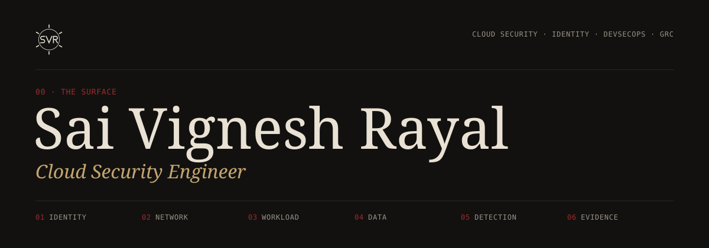
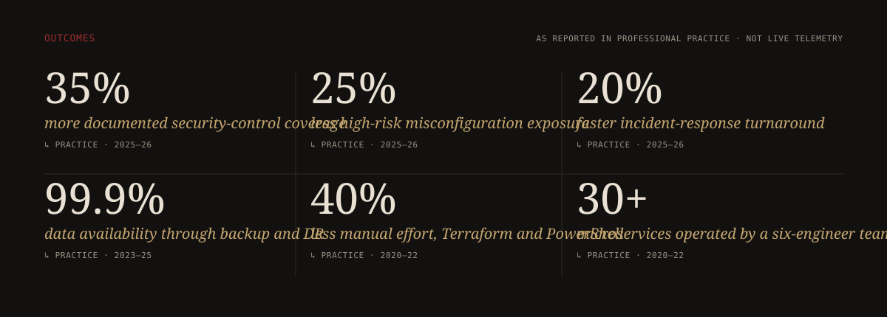

Five-plus years securing, automating and supporting Azure, AWS and Microsoft 365 — across healthcare research, cloud infrastructure and enterprise endpoint estates. I design access so there is nothing to steal, write the controls as code, and keep the evidence that proves they hold.

Structured like a System Security Plan. Every statement cites its source; outcome figures are as reported in the résumé, not live telemetry. The full package is at <a href="https://saivignesh-1177.github.io/Saivignesh-1177/">saivignesh-1177.github.io/Saivignesh-1177/</a>.

**Roles in scope** · Cloud Security Engineer · Identity & Access Management Engineer · DevSecOps Engineer · GRC / Security Compliance Engineer · Microsoft security roles — architecture, operations, identity, Azure security

## §3 Control implementation

<code>AC · IA</code> <b>Identity & Access</b> — <i>Workload access built so no reusable credential exists.</i>

- Managed identity scoped to Key Vault Secrets User on exactly one secret; a decoy secret proves the boundary with a 403.  
  ↳ [`azure-iam-zero-trust-lab`](https://github.com/Saivignesh-1177/azure-iam-zero-trust-lab)
- Secretless CI/CD through GitHub OIDC, with an ABAC condition limiting which role the pipeline can grant.  
  ↳ [`azure-iam-zero-trust-lab`](https://github.com/Saivignesh-1177/azure-iam-zero-trust-lab)
- Access-control reviews; cloud solutions integrated securely while supporting researcher access needs.  
  ↳ *Résumé · UW–Madison SMPH · 2025–26*

<code>SC · CM</code> <b>Cloud Boundary & Configuration</b> — <i>Networks default-deny; configuration is code and is tested before it exists.</i>

- Key Vault reachable only from the workload subnet; 31 tests run against the compiled template before deploy.  
  ↳ [`azure-iam-zero-trust-lab`](https://github.com/Saivignesh-1177/azure-iam-zero-trust-lab)
- Sealed AWS lab network: no internet gateway, no NAT, no public IPs, quarantine subnet, guardrail tests in CI.  
  ↳ `living-museum-of-cyber-warfare` *(release pending)*
- Secured Azure VMs, networking and storage while reducing infrastructure cost 15%.  
  ↳ *Résumé · Kgate · 2023–25*
- Designed AWS architectures on EC2, EKS, VPC, S3 and RDS with security controls, load balancing and auto-scaling.  
  ↳ *Résumé · Tata Consultancy Services · 2020–22*

<code>RA · CA</code> <b>Risk & Assessment</b> — <i>Find the misconfiguration before an attacker does, and write down what remains.</i>

- Vulnerability testing and security assessments across infrastructure, access and configuration — high-risk misconfiguration exposure down 25%.  
  ↳ *Résumé · UW–Madison SMPH · 2025–26*
- STRIDE threat model (T01–T15), eight adversary-emulation scenarios, findings fixed and re-tested or formally risk-accepted.  
  ↳ [`azure-iam-zero-trust-lab`](https://github.com/Saivignesh-1177/azure-iam-zero-trust-lab)

<code>AU · SI-4 · IR</code> <b>Detection & Response</b> — <i>Every read, denial and permission change is logged, alerted and rehearsed.</i>

- KQL hunts for secret reads, denials, unexpected networks, RBAC changes and log tampering; incident runbooks for token theft and escalation.  
  ↳ [`azure-iam-zero-trust-lab`](https://github.com/Saivignesh-1177/azure-iam-zero-trust-lab)
- Monitored cloud systems for irregular behaviour and supported triage, containment and remediation — response turnaround 20% faster.  
  ↳ *Résumé · UW–Madison SMPH · 2025–26*
- VPC flow logs on all traffic to encrypted storage; sensor subnet reserved for Zeek and Suricata.  
  ↳ `living-museum-of-cyber-warfare` *(release pending)*

<code>SA · SR</code> <b>DevSecOps & Supply Chain</b> — <i>The pipeline is a security control, not a delivery convenience.</i>

- CI runs Bicep lint with security rules as errors, Checkov, Gitleaks over full history and traceability tests.  
  ↳ [`azure-iam-zero-trust-lab`](https://github.com/Saivignesh-1177/azure-iam-zero-trust-lab)
- Terraform and PowerShell provisioning — manual effort down 40%, deployments consistent.  
  ↳ *Résumé · Tata Consultancy Services · 2020–22*
- Azure administration automated with PowerShell and JSON templates — manual effort down 30%.  
  ↳ *Résumé · Kgate · 2023–25*

<code>SI-2 · AC-4</code> <b>Data Protection & Endpoint</b> — <i>Regulated data stays classified, contained and on compliant devices.</i>

- Microsoft Security & Compliance Center policies — DLP and threat-management controls — and Defender across Microsoft 365.  
  ↳ *Résumé · Kgate · 2023–25*
- Intune and SCCM across 500+ devices: compliance enforcement, patching, device policy — security incidents down 25%.  
  ↳ *Résumé · Tata Consultancy Services · 2020–22*

<code>PL · PM · CP</code> <b>Governance, Risk & Compliance</b> — <i>Controls are mapped, traceable, and a build fails if a threat loses its control.</i>

- Security requirements and control mappings for healthcare and research platforms — documented control coverage up 35%.  
  ↳ *Résumé · UW–Madison SMPH · 2025–26*
- 29 NIST SP 800-53 Rev 5 controls mapped to implementation, test, evidence and threat; crosswalk to CSF 2.0, SP 800-207, CIS and MCSB.  
  ↳ [`azure-iam-zero-trust-lab`](https://github.com/Saivignesh-1177/azure-iam-zero-trust-lab)
- Standards, runbooks, continuity and disaster-recovery procedures — audit readiness and resilience up 30%; HIPAA-aligned and NIST-based practice.  
  ↳ *Résumé · UW–Madison SMPH · 2025–26*
- Backup and DR for Azure resources and SQL databases supporting 99.9% availability.  
  ↳ *Résumé · Kgate · 2023–25*

## §4 Evidence

| Repository | Statements citing it |
|---|---|
| [`azure-iam-zero-trust-lab`](https://github.com/Saivignesh-1177/azure-iam-zero-trust-lab) | 7 |
| `living-museum-of-cyber-warfare` *(release pending)* | 2 |

## §5 Operating history

| Period | Role | Organisation |
|---|---|---|
| Apr 2025 – Apr 2026 | Cybersecurity Engineer II / Cloud Security Engineer | University of Wisconsin–Madison · School of Medicine and Public Health · Madison, WI |
| Apr 2023 – Mar 2025 | Cloud Engineer — Security & Infrastructure | Kgate · Houston, TX |
| Feb 2020 – Jun 2022 | Microsoft Cloud Solution Engineer — Security, Compliance & Endpoint | Tata Consultancy Services · Bengaluru, India |

## §6 Plan of action & milestones

Open work, stated plainly.

| ID | Item | Where |
|---|---|---|
| `EVD-008` | Azure Policy and Defender CSPM report captured as evidence | [`azure-iam-zero-trust-lab`](https://github.com/Saivignesh-1177/azure-iam-zero-trust-lab) |
| `EVD-010` | GitHub OIDC deployment run recorded | [`azure-iam-zero-trust-lab`](https://github.com/Saivignesh-1177/azure-iam-zero-trust-lab) |
| `EVD-011` | MFA enforcement evidence captured | [`azure-iam-zero-trust-lab`](https://github.com/Saivignesh-1177/azure-iam-zero-trust-lab) |
| `LM-SEN` | Sensor layer: Zeek and Suricata with VPC traffic mirroring | `living-museum-of-cyber-warfare` *(release pending)* |
| `LM-STATE` | Terraform state moved to a private, locked S3 backend | `living-museum-of-cyber-warfare` *(release pending)* |

## §7 Credentials & contact

- **Microsoft Certified: Azure Administrator Associate**
- **Master of Artificial Intelligence — University of North Texas** — Coursework: Cloud Computing, Networking, Computer Algorithms, Software Development with AI

[rollasaivigneshrayal@gmail.com](mailto:rollasaivigneshrayal@gmail.com) · United States · open to relocate

---

Generated from <code>profile.json</code> — the same source as the site and the artwork. Typefaces: Instrument Serif and IBM Plex (SIL Open Font License), self-hosted. No trackers or third-party requests.
